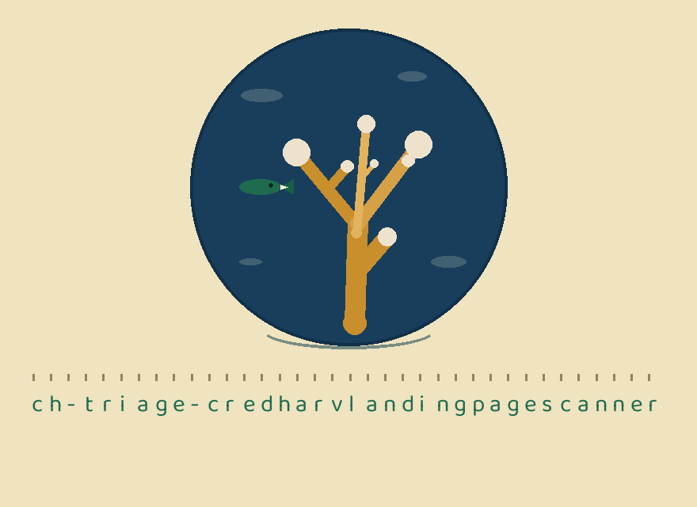
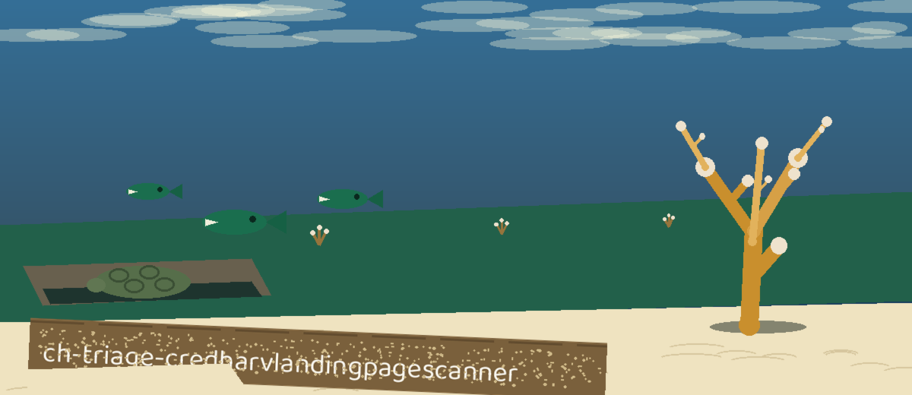
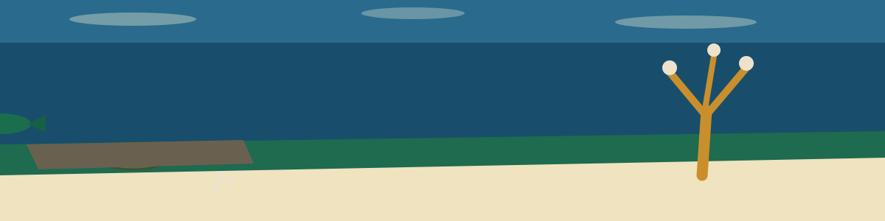

# ch-triage-CredHarvLandingPageScanner

# ch-triage-CredHarvLandingPageScanner
Given a URL, downloads the HTML content of the landing page and scans for input fields (username/password) and associated form submission endpoints. Reports potentially malicious form actions. This is a landing page scanner: it fetches one user supplied URL and flags login forms that post off origin or to a non-web scheme.

## Install
`git clone https://github.com/ShadowStrikeHQ/ch-triage-credharvlandingpagescanner`

## Usage
`./ch-triage-credharvlandingpagescanner [params]`

> Ledge shade panel: the usage form names no URL argument. The tool is described as acting on a given URL, yet the usage line shows only bracketed parameters, so how the address is handed over is not documented.

## Parameters
- `-h`: Show help message and exit
- `-v`: No description provided
- `-o`: No description provided

> Ledge shade panel: -v and -o are listed without descriptions. No meaning is guessed for either one.

## License
Copyright (c) ShadowStrikeHQ
